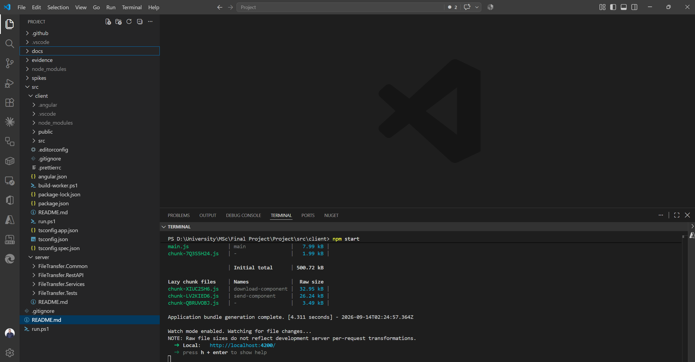

# File Transfer Client

Angular client for the Resilient and Confidential Browser-Based File Transfer Application.

The client handles the file selection, uploading, client-side encryption, resumable upload state, download, decryption and integrity verification.

## Install dependencies

```bash
npm install
```

## Run

To start a local development server, run:

```bash
ng serve
```

Once the server is running, open your browser and navigate to `http://localhost:4200/`. The application will automatically reload whenever you modify any of the source files.

## Tests

To run the client-side tests using Vitest:

```bash
ng test
```

## Running Application



## Test Results


---

[← Back to main README](../../README.md)