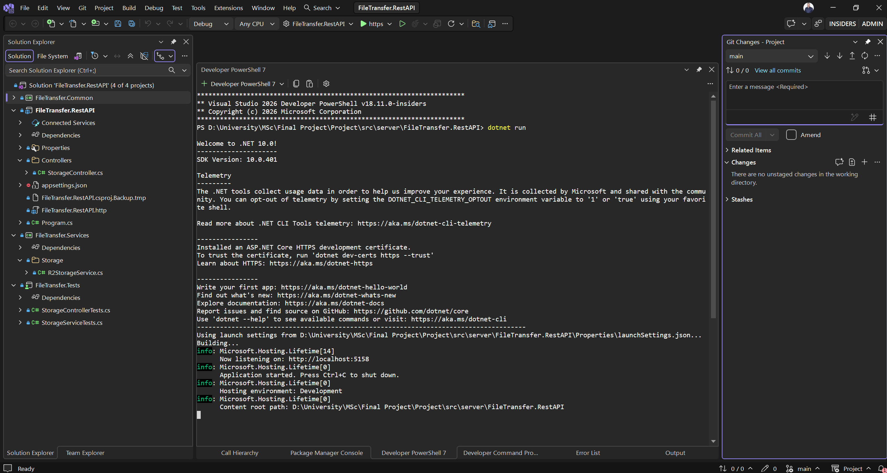

# File Transfer API

ASP.NET Core API for the Resilient and Confidential Browser-Based File Transfer Application.

The server handles the file transfers and communication with Cloudflare R2.

## Install dependencies

.NET 10 SDK

## Run

To start a local development server, run:

```bash
dotnet run
```

## Tests

To run the server-side tests using xUnit:

```bash
dotnet test
```

## Running Application



---

[Back to main README](../../README.md)
